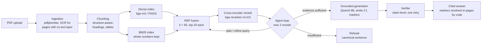

# Agentic RAG over PDFs, measured

A question-answering system over PDFs that runs on a free Colab T4. It
handles ingestion with OCR, structure-aware chunking, dense + BM25 retrieval
fused with RRF, a cross-encoder reranker, and a bounded agent loop (planner,
evidence controller, refinement, verifier). Every answer cites pages that code
resolves, not the model. The hard part is not wiring these together. It is
knowing which of them actually helps. So the repo carries a benchmark (76
human-verified questions over 5 PDFs, dev/eval split), paired-bootstrap
confidence intervals, a failure taxonomy, and a written decision (a "DD") for
every judgment call, including the ones where the fancier component lost.

> **Every number in this README comes from the offline stand-in stack:** a
> hashing embedder, a scripted extractive generator, a term-overlap reranker
> and rule-based agents, run on a CPU. None is a Qwen3-4B / bge-m3 /
> bge-reranker-v2-m3 result. **The GPU model-stack run has not been done**
> ([NEXT_STEPS.md](NEXT_STEPS.md)). The offline numbers are real measurements
> of a real, weak system. They test the harness and the engineering, not the
> models.

**Contents:**
[Architecture](#architecture) ·
[The hard parts](#the-hard-parts-and-the-tradeoffs-i-made) ·
[Evaluation](#evaluation-harness) ·
[Results](#results) ·
[Limitations](#honest-limitations) ·
[Quick start](#quick-start) ·
[Talking points](#interview-talking-points)

---

## Architecture



The modules are independent, and each is switchable by one config field
(`src/config.py`, DD-017). The dense, hybrid and agentic systems share every
layer they have in common, so a comparison between them changes one thing at a
time ([ARCHITECTURE.md](ARCHITECTURE.md)).

---

## The hard parts and the tradeoffs I made

Each subsection covers the decision, the alternatives I considered, why I
chose as I did, the measured evidence (offline stand-in stack, 95% CI), what I
would do at scale, and the DD. Depth lives in [docs/TRADEOFFS.md](docs/TRADEOFFS.md)
and [DESIGN_DECISIONS.md](DESIGN_DECISIONS.md).

### 1. Chunking

* **Decision:** structure-aware chunks. A heading starts a chunk and is
  repeated at the top of every chunk in its section. Tables get their own
  chunk, split by rows with the header repeated. Size 1200 characters, overlap
  150.
* **Alternatives:** fixed-size character windows; sizes 400-1600; overlap 0 or
  150.
* **Why:** a chunk retrieved without its heading reads as if it belonged to
  whatever came before it. A table cut mid-row loses its column names.
* **Evidence** (DD-071, a 16-arm dev sweep, rule committed before the runs):
  * No setting beat the incumbent under the pre-declared rule.
  * Fixed windows were a near-miss: dev Recall@5 +0.067 [+0.000, +0.167],
    which is two questions.
  * `chunk_size` barely changes structure-aware chunks: short sections cap
    them at about 390 characters.
  * Structure-aware chunking **loses on tables**, whose chunk is cut off from
    the sentence that introduces it.
  * Table: [results/experiments/chunking/TABLE.md](results/experiments/chunking/TABLE.md).
* **At scale:** merge adjacent short sections up to the size cap, attach each
  table's caption to its chunk, and re-sweep with a real embedder.
* **DDs:** [DD-009](DESIGN_DECISIONS.md), DD-030, DD-061, **DD-071**.

### 2. Hybrid search

* **Decision:** dense + BM25, fused by Reciprocal Rank Fusion (k = 60). Each
  retriever ranks to 20. BM25 keeps numbers whole and does no stemming.
* **Alternatives:** dense only; BM25 only; weighted score fusion.
* **Why:** RRF needs no score calibration between two retrievers whose scores
  are not comparable. BM25 catches exact numbers and identifiers that
  embeddings blur.
* **Evidence** (all 76 questions, Baseline B − dense Baseline A):
  * MRR@10 +0.071 [+0.003, +0.145], significant;
  * Recall@5 +0.057 [−0.014, +0.143], not significant;
  * accuracy +0.039 [−0.013, +0.092], not significant.
* **Fusion study:** RRF k × candidate depth, plus which retriever wins on
  numeric, lexical and paraphrase questions — *pending: DD-072, issue #32*.
* **At scale:** sweep the fusion weights on the model stack, where the dense
  side is a real embedder rather than a second lexical signal.
* **DDs:** DD-008, DD-045, DD-046, DD-049, **DD-072**.

### 3. Re-ranking

* **Decision:** a cross-encoder reorders the fused top 20. It is on by default
  and switchable (`--no-rerank`).
* **Alternatives:** no reranker; a larger pool; an LLM reranker, which would
  cost a generation call on the GPU that already holds the generator.
* **Why:** a cross-encoder reads the query and passage together. Its cost is
  one batched forward pass per pair, with no generation.
* **Evidence** (all 76 questions, reranker ON − OFF on Baseline B):
  * MRR@10 +0.032 [−0.020, +0.089];
  * accuracy +0.026 [−0.026, +0.079];
  * neither is significant, and latency is the only significant contrast.
* **The cost that carries over** to the model stack is 17.2 cross-encoder
  passes per question, 29.7 in the agentic system — *write-up: A3, PR #38*.
* **At scale:** budget the pool by measured p95 latency per pair batch, skip
  reranking when fusion's top hit is a clear winner, and cache scores per
  (query, chunk).
* **DDs:** DD-044, DD-046, DD-048.

### 4. The agent loop and bounded iterations

* **Decision:** an explicit loop with four components, each switchable: a
  planner that splits multi-hop questions, an evidence controller, query
  refinement, and a verifier. The caps are hard: at most 2 retrieval rounds
  and one regeneration. Every step is written to a per-question trace.
* **Alternatives:** a free-form ReAct agent; no loop at all (Baseline B).
* **Why:** a loop with no cap has unbounded latency and cost on a T4. A trace
  makes every refusal explainable.
* **Evidence** (agentic − Baseline B, all 76 questions):
  * faithfulness −0.079 [−0.145, −0.026], a significant regression;
  * citation any-correct −0.057 [−0.114, −0.014], a significant regression;
  * accuracy −0.013 [−0.066, +0.026], not significant.
* The ablations trace the regression to the rule-based evidence controller,
  which refuses answerable questions. Removing it recovers faithfulness
  +0.079 [+0.026, +0.145].
* On dev, an iteration cap of 3 is identical to 2.
* **The agentic system is not kept**, and that verdict was declared before
  the run.
* **At scale:** re-measure with the LLM controller. The rule-based stand-in is
  the likeliest reason the loop lost.
* **DDs:** DD-050 to DD-060, DD-069.

### 5. Citations resolved by code, not by the model

* **Decision:** the generator sees a numbered evidence list and emits `[C1]`
  markers. It never sees a page number. Code maps each marker to its chunk's
  pages. A bare `[3]` copied from a bibliography is not mistaken for a
  citation.
* **Alternatives:** let the model write page numbers; post-hoc attribution by
  similarity.
* **Why:** a page number a model writes can be invented. A marker resolved
  against the evidence list cannot point outside it.
* **Evidence:**
  * 0 of 228 stored answers mention a page that was not in the evidence
    (dense, hybrid and agentic). This holds by construction on this stack:
    the scripted generator cannot invent a page.
  * Citation any-correct is 0.686 on Baseline B.
* **At scale:** sentence-level attribution checks, so that a correct page is
  also the page that supports that particular sentence.
* **DDs:** DD-031, DD-042, DD-062.

### 6. Refusal and abstention

* **Decision:** refuse with one fixed, canonical sentence. Score abstention
  from the answer text, with the model's own report recorded beside it.
  Unanswerable questions get their own denominators.
* **Alternatives:** a retrieval-score threshold. It is left off: no untuned
  threshold is allowed.
* **Why:** a fixed sentence makes refusals countable and testable. A
  self-reported "I'm not sure" is not the same thing.
* **Evidence:**
  * Abstention accuracy on the 6 unanswerable questions is **0.000 for both
    baselines** and 0.167 for the agentic system; every system answers almost
    every unanswerable question.
  * Tuning the controller threshold on dev to refuse more (0.6) refused one of
    3 eval unanswerables, and raised over-abstention by +0.175
    [+0.075, +0.300] on eval.
* **At scale:** this is the stack's weakest point. A real model's calibrated
  evidence check is the first thing the GPU run should measure.
* **DDs:** DD-043, DD-052, DD-063, DD-069.

### 7. OCR

* **Decision:** Tesseract, on by default, **only for pages with no text
  layer**. A page that has text is never re-OCR'd.
* **Alternatives:** OCR every page; a layout model.
* **Why:** OCR on a born-digital page can only add noise. A missing engine
  fails with a remedy rather than silently.
* **Evidence:**
  * Tests verify it on synthetic scanned PDFs.
  * It provably changes nothing on the 5 benchmark PDFs, which all have a
    text layer.
  * **There is no OCR accuracy figure.** The benchmark has no scanned
    document.
* **At scale:** add a scanned-document suite with gold text, and report
  character error rate.
* **DD:** DD-067.

### 8. Stale and conflicting sources

* **Decision (proposed, under review):**
  * version metadata per document: a user-supplied date, then the PDF date,
    then the filename, recording which one was used;
  * cross-document conflict detection, with a rule path and an LLM path;
  * a declared policy: the newer source wins and the answer says so, citing
    both; unknown dates refuse.
* **Evidence:** *pending: design DD-074 ([PR #39](https://github.com/manishtiwari2/agentic-rag-pdf/pull/39)),
  measurement DD-075, on a separate conflict suite*.

---

## Evaluation harness

Details: [docs/EVALUATION.md](docs/EVALUATION.md) and
[EVALUATION_PROTOCOL.md](EVALUATION_PROTOCOL.md).

* **Dataset:**
  * 76 questions over 5 PDFs (56 pages), spanning 10 question types: factual,
    numerical, table, multi-hop, comparison, unanswerable and more.
  * Every evidence page was checked by a person against the rendered PDF.
    Three errors in the AI-drafted set were found and fixed this way.
* **Dev/eval discipline:**
  * 33 dev / 43 eval.
  * Every tuning choice is made on dev, by a rule committed before the run.
  * Eval has been looked at **twice** (DD-059, DD-069), and each look is
    disclosed.
* **Metrics, and why each:**
  * page-level Recall@k / MRR@10, so chunking choices stay comparable;
  * Full-Recall@5, which tells whether a multi-hop question got every page it
    needs;
  * deterministic answer correctness (token overlap plus exact numbers, with
    no LLM grading);
  * faithfulness;
  * citation correctness;
  * abstention on all four cells of the outcome matrix;
  * p95 latency, never the mean alone.
* **Statistics:**
  * a paired bootstrap over questions (2,000 resamples) for every contrast;
  * the primary metrics are named before each run;
  * every contrast is counted, so one significant result among many reads as
    a hypothesis.
* **Failure taxonomy:** nine ordered categories, and each failing record gets
  exactly one.
* **Reproduce:** `python -m src.cli run-benchmark --system hybrid --offline`,
  then `compare-runs`, then `final-table`. A test checks the 76-question runs
  record by record against `results/`.

---

## Results

Eval split, 43 questions, generated from
[results/final/REPORT.md](results/final/REPORT.md) by
`python -m src.cli readme-table`.

<!-- BEGIN GENERATED: eval headline from results/final/REPORT.md (python -m src.cli readme-table) -->
> Offline stand-in stack: hashing embedder, scripted extractive generator, term-overlap reranker, rule-based planner / evidence controller / verifier. No figure here is about Qwen3-4B, bge-m3 or bge-reranker-v2-m3.

| System | n | Recall@5 | MRR@10 | Accuracy | Faithfulness | Citation any-correct | Abstention accuracy | P95 latency (s) |
| --- | ---: | ---: | ---: | ---: | ---: | ---: | ---: | ---: |
| Dense RAG (Baseline A) | 43 | 0.850 [0.725, 0.950] | 0.740 [0.614, 0.854] | 0.140 [0.047, 0.256] | 0.953 [0.884, 1.000] | 0.625 [0.475, 0.775] | 0.000 [0.000, 0.000] | 0.003 [0.002, 0.003] |
| Hybrid RAG (Baseline B) | 43 | 0.950 [0.875, 1.000] | 0.854 [0.767, 0.933] | 0.209 [0.093, 0.349] | 0.953 [0.884, 1.000] | 0.675 [0.525, 0.825] | 0.000 [0.000, 0.000] | 0.005 [0.004, 0.005] |
| Agentic RAG (threshold 0.5) | 43 | 0.950 [0.875, 1.000] | 0.855 [0.766, 0.938] | 0.163 [0.070, 0.279] | 0.907 [0.814, 0.977] | 0.625 [0.475, 0.775] | 0.000 [0.000, 0.000] | 0.020 [0.016, 0.023] |
| Agentic RAG (threshold 0.6, tuned on dev) | 43 | 0.950 [0.875, 1.000] | 0.855 [0.766, 0.938] | 0.140 [0.047, 0.256] | 0.774 [0.635, 0.890] | 0.525 [0.375, 0.675] | 0.333 [0.000, 1.000] | 0.010 [0.007, 0.017] |

| System | Avg retrieval iterations | Avg model calls | Peak VRAM (GB) |
| --- | ---: | ---: | ---: |
| Dense RAG (Baseline A) | null | null | null (no GPU; not measured) |
| Hybrid RAG (Baseline B) | null | null | null (no GPU; not measured) |
| Agentic RAG (threshold 0.5) | 1.023 [1.000, 1.070] | 0.907 [0.814, 0.977] | null (no GPU; not measured) |
| Agentic RAG (threshold 0.6, tuned on dev) | 1.116 [1.023, 1.233] | 0.767 [0.628, 0.884] | null (no GPU; not measured) |

Each cell is the value and its 95% percentile-bootstrap CI over questions (2,000 resamples, seed 42). P95 latency is nearest-rank, with a bootstrap CI of the same statistic. Iterations and model calls are null for the baselines, which report neither (DD-055). Latencies are milliseconds on a stack that loads no weights, and were measured in different sessions.
<!-- END GENERATED -->

---

## Honest limitations

* **The GPU model-stack run is pending.** No Qwen3-4B, bge-m3 or
  bge-reranker-v2-m3 number exists yet.
* **The LLM judge has not been run.** It is built and off by default. Answer
  quality is scored deterministically.
* **The offline generator copies sentences.** Accuracy is capped by that, not
  only by retrieval (about 0.21 on eval for Baseline B).
* **Small data:**
  * 43 eval questions, so most CIs span ±0.1;
  * 6 unanswerable questions, so abstention CIs span [0, 1];
  * 3 multi-hop questions on dev.
* **Eval has been looked at twice.** Defects found partly by reading eval
  failures were fixed (DD-060, DD-069).
* **Licences:** only one of the five benchmark PDFs has a confirmed open
  licence. The other four are recorded as unknown, with the owner's sign-off.
* **No OCR accuracy figure:** there is no scanned document with gold text.

---

## Quick start

**Colab (recommended):** open
[`notebooks/agentic_pdf_rag.ipynb`](notebooks/agentic_pdf_rag.ipynb) in Colab,
choose a T4 runtime, then *Run all*. With no GPU it runs the offline stack and
says so.

**Chat app:**

```bash
pip install -r requirements-colab.txt
python -m src.cli chat --offline          # local, CPU, stand-in stack
python -m src.cli chat --share            # model stack, prints a public gradio.live link
```

**CLI:**

```bash
pip install -r requirements.txt
python -m src.cli ask --pdf paper.pdf --question "What was measured?" --offline
python -m src.cli run-benchmark --system hybrid --offline --split dev
python -m src.cli final-table
```

Further commands and the Python API: [docs/PROJECT_README_ARCHIVE.md](docs/PROJECT_README_ARCHIVE.md#191-quick-start).

---

## Interview talking points

* **Measure first, then build.** I built the 76-question benchmark and the
  paired-bootstrap harness before any retrieval improvement. It cost the
  longest phase of the project, and it is why every claim below has a CI.
* **Fusion that needs no calibration.** I chose RRF over weighted score
  fusion because dense and BM25 scores are not comparable and RRF needs no
  calibration. It bought MRR@10 +0.071 [+0.003, +0.145] over dense alone, for
  about 1.4 ms more per question offline (DD-045).
* **Citations resolved by code.** I chose code-resolved `[C1]` markers over
  letting the model write page numbers, so no answer can cite a page outside
  its evidence. The cost: the generator must follow a marker format, and a
  bibliography `[3]` needed its own rule (DD-031, DD-062).
* **I dropped my own agent loop.** I chose to report that the agentic system
  regressed faithfulness by −0.079 [−0.145, −0.026], rather than tune until it
  won. The ablation pinned the cause on the evidence controller (DD-060).
* **Rules committed before results.** I chose a pre-committed decision rule
  over picking the best-looking arm. In DD-071 it kept the default chunking
  even though fixed windows looked better on dev (+0.067 Recall@5, two
  questions); a lower bound at exactly 0 is not evidence.
* **Bounded loops.** I chose a capped loop (2 rounds, 1 regeneration) over an
  open-ended agent, because a T4 has a latency budget. On dev, a third round
  changed nothing (DD-059, DD-069).
* **One fixed refusal sentence.** I chose a canonical refusal sentence over
  free-form hedging, so refusals can be counted. It exposed that every system
  here fails almost all unanswerable questions, which is the first thing the
  GPU run must fix.
* **Honest offline stand-ins.** I chose dependency-free stand-ins for every
  model, so the whole pipeline and the notebook are tested on a CPU in CI. The
  cost: every number in this README is about the harness, not about the
  models, and it says so.

---

**Licence:** Apache-2.0 ([LICENSE](LICENSE), [NOTICE](NOTICE)) ·
**Status record:** [STATUS.md](STATUS.md) ·
**All decisions:** [DESIGN_DECISIONS.md](DESIGN_DECISIONS.md)
