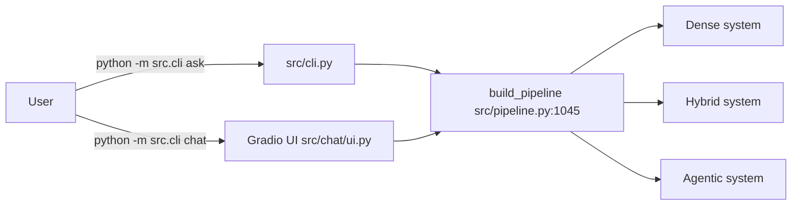
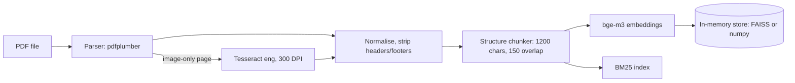
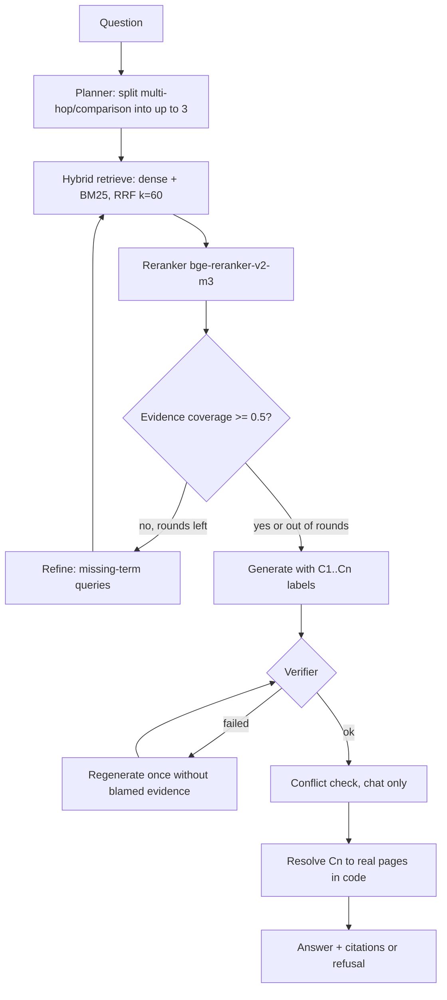

# Flow: how data moves today

Today there is no API server, no database and no login. Data moves through a
CLI or a Gradio UI, inside one Python process. The planned production flow
(FastAPI, Postgres, Ollama) is in `ROADMAP.md`. Update this file when it lands.

## 1. Entry points

The strategy is fixed by config (`retrieval.strategy`, default `dense`). There is no
routing at runtime.

## 2. Ingestion (once per PDF)

The index lives in memory only. Restarting the app or clicking Index again rebuilds it.

## 3. Answering a question (agentic strategy)

## 4. State
- Settings: one frozen config object (`src/config.py`). Nothing is read from env vars.
- Per question: `AgentState` counts rounds and model calls (`src/pipeline.py`).
- Per chat: `src/chat/session.py` keeps the history and rewrites follow-up questions.
- Models: loaded lazily per pipeline instance (`src/generation/backends.py:181`).
- Auth: none. `--share` makes a public Gradio link with no login.
