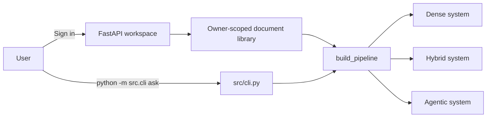
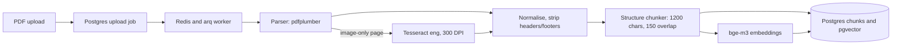
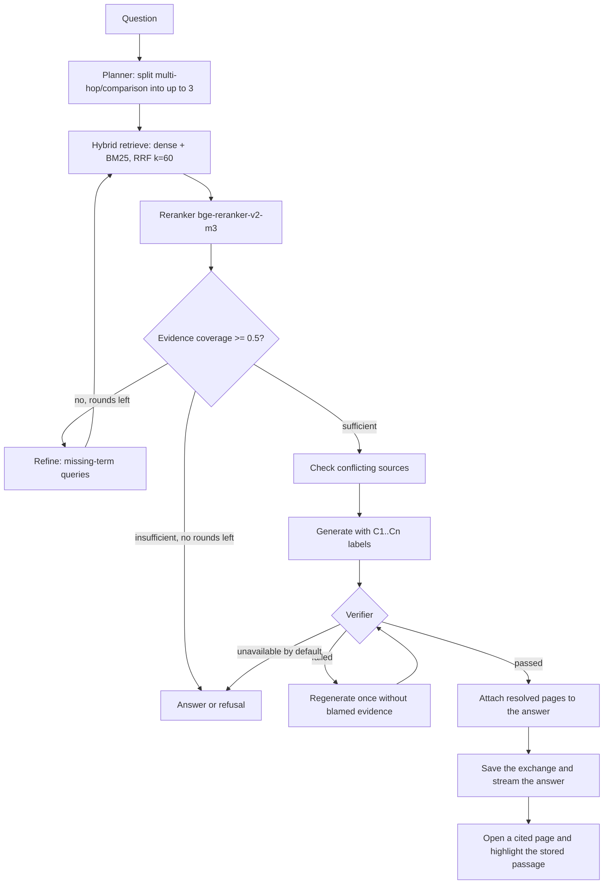

# Flow: how data moves today

The authenticated web workspace uses FastAPI, Postgres, Redis, and an
OpenAI-compatible model server. The CLI and notebook can also run a local
pipeline for experiments.

## 1. Entry points

The web workspace uses the agentic strategy. The CLI selects a strategy
through its existing configuration.

## 2. Ingestion (once per PDF)

The web library reuses saved vectors by owner, file hash, config fingerprint,
and code version. It builds BM25 from the versions selected for a question.
The local CLI and notebook keep their indexes in memory.

## 3. Answering a question (agentic strategy)

## 4. State
- The API and worker read connection and deployment settings from the environment.
- Postgres stores upload state, sessions, document versions, and chat history under their owner.
- Redis holds the ingestion queue and request counters.
- Each API process shares its embedder, reranker, and model client.
- The pipeline records its per-question decisions in `AgentState`.
